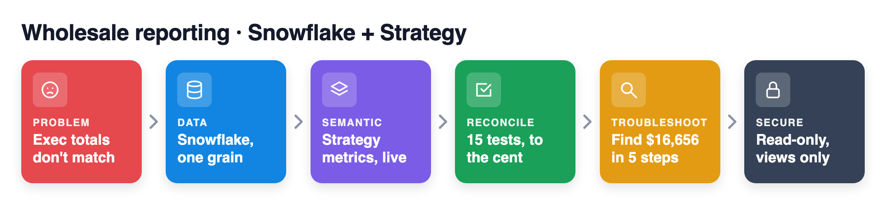
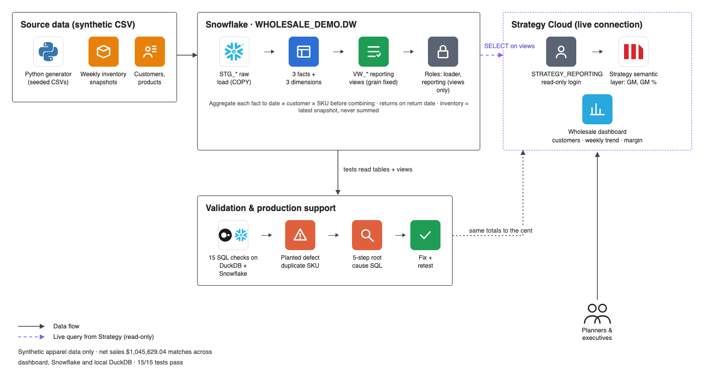
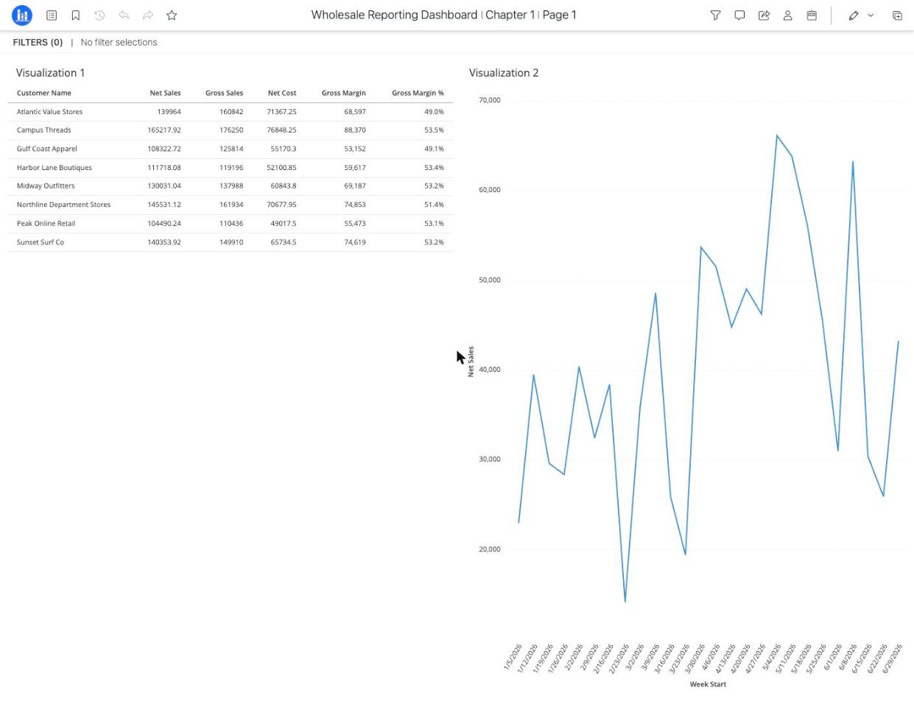
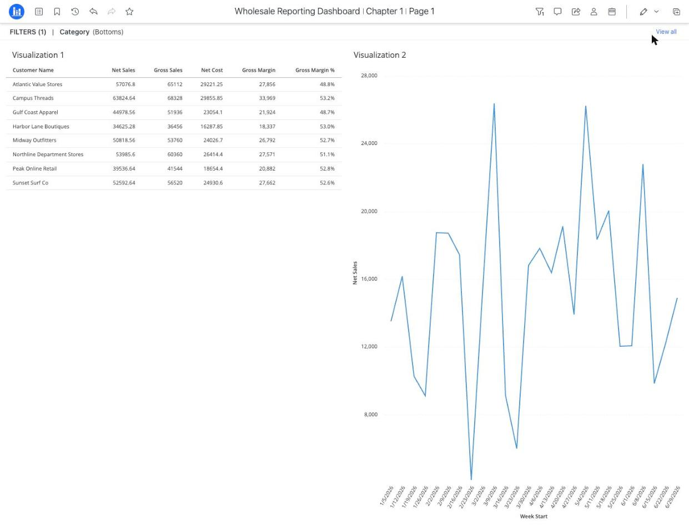

# Wholesale Reporting Accelerator: numbers executives can trust, and a fast answer when they don't match

> **Reporting + production-support case study, working end to end** · Apparel wholesale · Snowflake · Strategy (MicroStrategy) · SQL reconciliation · **Synthetic data only. Not any real retailer's systems or data.**

**▶ 60-second walkthrough (plays automatically)**


## How it works









| Result | Value |
|---|---|
| Net sales: dashboard = Snowflake = local test run | **$1,045,629.04** |
| Tests on a clean load (Snowflake and DuckDB) | **15 / 15 pass** |
| Planted defect | **$16,656** overstatement, caught by 6 tests, traced to 1 SKU in 5 SQL steps |
| Dashboard access | Read-only service login; **views only**, tables are invisible |

### Data

| | |
|---|---|
| **Dataset** | Generated by `data_gen/generate.py` (seeded, so it's identical on every run): 8 wholesale customers, 180 SKUs, 26 weeks, 1,953 order lines, 141 returns, 4,680 weekly inventory snapshots |
| **Why synthetic** | Real wholesale data is confidential. The schema mirrors a typical retail model: orders, returns linked to order lines, and weekly inventory |
| **Real or simulated** | Snowflake, the Strategy dashboard and the tests are **real and running**. The data is **synthetic** |
| **Run it yourself** | `python tests/run.py` runs everything locally on DuckDB with no account needed. Add `--target snowflake` to run against Snowflake |

## 1. User and problem
Wholesale planners and executives need one place to see revenue and margin by customer, product and week, and to compare against the prior week. The bigger pain is trust. When an executive's number doesn't match finance's, someone has to explain why within the hour, and a wrong join in the reporting layer can quietly inflate totals.

## 2. Goal
Build wholesale reporting **on top of an existing Snowflake model**, not a new warehouse, so that:
- every dashboard total can be reconciled to an independent SQL total, and
- any mismatch can be traced to its root cause with a repeatable runbook.

## 3. Data model and grain

| Table | One row = | Key |
|---|---|---|
| `FACT_ORDER_LINE` | one line on a wholesale order | `ORDER_LINE_ID` |
| `FACT_RETURN_LINE` | one return against **one** original order line | `RETURN_ID` → `ORDER_LINE_ID` |
| `FACT_INVENTORY_SNAPSHOT` | one SKU at one weekly close | `SNAPSHOT_DATE + SKU` |
| `DIM_PRODUCT` / `DIM_CUSTOMER` / `DIM_DATE` | one SKU / account / date | `SKU` / `CUSTOMER_ID` / `DATE_KEY` |

**How duplicated totals are prevented** (`sql/model/03_views.sql`):
- **Aggregate first, combine second.** Sales and returns are each summed to date × customer × SKU, then joined on that key.
- **Never join orders to inventory.** Different grains multiply rows. Inventory has its own view.
- **Inventory is a stock.** It uses the latest snapshot and is never summed across dates.
- **Tested every load:** unique keys on every table, and the view must carry exactly as many order lines as the fact (1,953 = 1,953).

## 4. Semantic layer (Strategy)

| Object | Definition | Why |
|---|---|---|
| Attributes | Customer, Region, Channel, Category, Style, Color, Size, SKU, Season, Week | The slices the business asked for |
| Base metrics | `Sum` of Gross Sales, Discount, Refund, Net Sales, Net Cost, Units | Additive, safe at any level |
| **Gross Margin** | `Sum(Net Sales) − Sum(Net Cost)` | Defined once, reused everywhere |
| **Gross Margin %** | `(Sum(Net Sales) − Sum(Net Cost)) / ZeroToNull(Sum(Net Sales))` | A ratio of totals, never an average of row percentages; null when net sales is 0 |
| Filters | Category, Customer | The most-used prompts |
| Data access | **Connect Live** | The dashboard can't drift from Snowflake |

**Built and validated:** everything in the table above, plus a customer grid and a weekly trend chart.
**Designed, not yet built** (`mstr/SEMANTIC_LAYER.md`): Category → Style → SKU and Year → Month → Week hierarchies, a prior-week metric, a date-range prompt, an inventory page and a region security filter.

## 5. Metric definitions

| Metric | Definition | Assumption to confirm with the business |
|---|---|---|
| Net sales | Gross − discount − refunds | Are freight and chargebacks deducted too? |
| Returns | Reported on **return date**, attributed to the original customer and SKU | Finance books refunds when issued; merchandising may want them on the sale date |
| Net cost | Cost sold − cost returned | Returned units go back to sellable stock |
| Gross margin / GM % | Net sales − net cost; ÷ net sales | Standard or actual cost? |
| Inventory on hand | Latest weekly snapshot in range | Is Sunday close the right snapshot? |

## 6. Reconciliation and troubleshooting

**Planted defect:** a product reload inserts a second row for SKU `ST120-BLK-M` instead of updating it.
**Symptom:** dashboard net sales of $1,062,285.04 vs source $1,045,629.04.

| Step | Question (`sql/scenario/02_investigate.sql`) | Finding |
|---|---|---|
| 1 | Dashboard vs independent fact total | +$16,656: the reporting layer adds money |
| 2 | Which weeks? | Many: not one bad load |
| 3 | Which customers? | All 8: not a customer mapping issue |
| 4 | Which SKUs, and how many lines? | One SKU: 40 lines in the view vs 20 in the fact |
| 5 | Duplicate keys in joined tables? | `DIM_PRODUCT` has 2 rows for that SKU |

**Fix:** rebuild the dimension with one row per SKU. **Validation:** all tests pass and net sales returns to $1,045,629.04 exactly.
**Prevention:** the unique-SKU and no-fan-out tests run after every load and block the refresh.
**Lesson:** the weekly-summary tie-out *passed* during the defect, because both sides read the same broken view. Always reconcile against an independent source.

## 7. Security and performance
- **Least privilege:** `WHS_LOADER` builds objects. Strategy uses `STRATEGY_REPORTING` (role `WHS_REPORTING`), which can `SELECT` from the 3 views only; querying a table returns "does not exist".
- **Verified in Snowflake query history:** every dashboard query runs as `STRATEGY_REPORTING` against `VW_WHOLESALE_SALES`.
- **No secrets in Git:** key-pair login for scripts; Strategy's token is scoped to the reporting role and expires in 30 days.
- **Slow report, step by step:** check query history for the generated SQL and where time went; read the query profile (bytes scanned, spilling, join explosion); check the warehouse (cold resume, queueing, size); then fix the model (pre-aggregate, cluster by date) or use a Strategy cube if freshness allows. In this demo one query took 7.6 s and the rest took 0.2–1 s; the slow one was a cold warehouse resume.

## 8. What I'd do next
- Build the remaining Strategy objects: hierarchies, prior-week metric, date prompt, inventory page.
- Add a region security filter and test it with two users.
- Write test results to a Snowflake table so the dashboard's data-quality page reads them live.
- Optional: an AI-written weekly summary, generated only from validated totals and shown next to the figures it cites.

**What this repo shows.** `tests/run.py` builds the model, runs 15 checks, injects the defect, runs the investigation, applies the fix and writes before/after results to `docs/TEST_RESULTS.md` (DuckDB) and `docs/TEST_RESULTS_SNOWFLAKE.md` (Snowflake). The two files match line for line. The talk track for a demo is in `docs/WALKTHROUGH.md`.

---
**How to run it**
```bash
python3 -m venv .venv && .venv/bin/pip install -r requirements.txt
.venv/bin/python data_gen/generate.py          # synthetic CSVs
.venv/bin/python tests/run.py                  # local DuckDB: build, test, defect, fix
# Snowflake (key-pair login; key lives in .keys/, git-ignored):
SNOWFLAKE_ACCOUNT=<org-account> SNOWFLAKE_USER=<login_name> SNOWFLAKE_PRIVATE_KEY_FILE=.keys/snowflake_rsa_key.p8 \
  .venv/bin/python tests/run.py --target snowflake --setup   # --setup only the first time
```

| Folder | Contents |
|---|---|
| `sql/snowflake/` | Roles, warehouse, load, read-only service user |
| `sql/model/` | Tables and reporting views (portable SQL) |
| `sql/tests/` | Reconciliation suite, known-row test, dashboard expected values |
| `sql/scenario/` | Inject defect → investigate → fix |
| `mstr/` | Strategy semantic layer spec and validation table |
| `docs/` | Walkthrough, requirements, design, runbook, test results |
| `docs/diagrams/` | Sources for the flow, architecture and GIF (`make_walkthrough.py`) |
