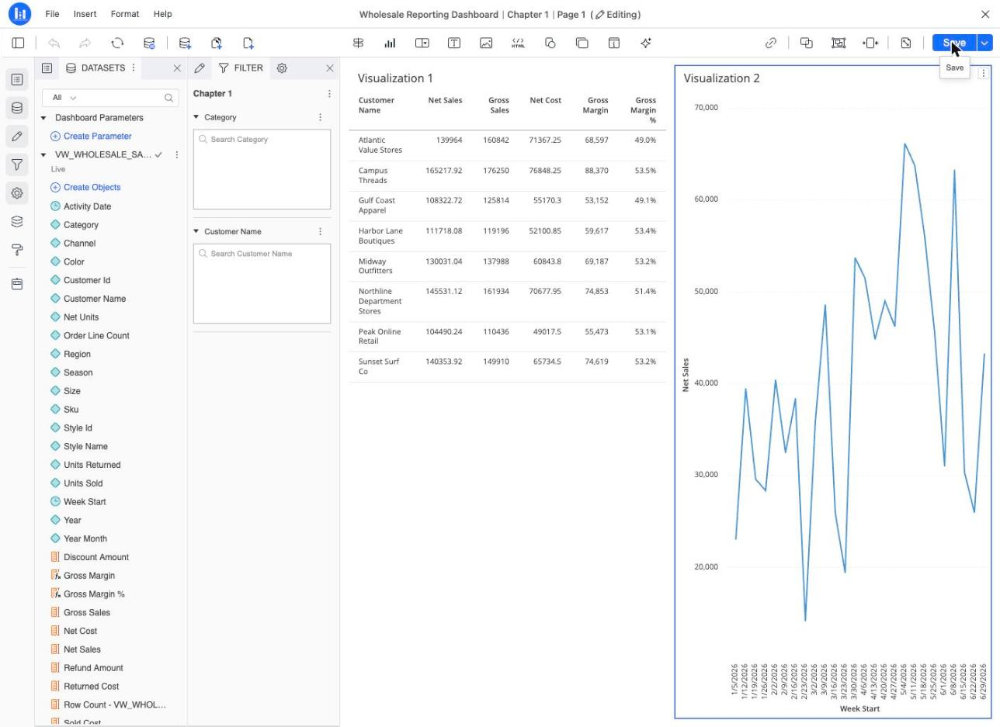

# Demo walkthrough: the six talking points

> Synthetic apparel data. Not Pacsun's systems, data or wholesale model.
> Every number below was produced by this repo and checked live on 2026-11-15.



---

## 1. Business problem

**What John described:** wholesale reporting on top of an existing Snowflake model,
and fast answers when an executive's number doesn't match.

**What I built:** the reporting layer, not a warehouse.

| Layer | What it is | Why it's small |
|---|---|---|
| Snowflake tables | 3 dims + 3 facts, loaded from synthetic CSVs | Stands in for "the existing model" |
| Snowflake views | `VW_WHOLESALE_SALES`, `VW_INVENTORY_POSITION`, `VW_WEEKLY_WHOLESALE_SUMMARY` | **This is the real work:** grain, returns policy, no fan-out |
| Strategy | Live connection, metrics, filters, dashboard | What business users see |
| Tests | 15 SQL checks + a defect scenario | How I prove the numbers are right |

Business questions answered: revenue and margin by customer / product / week; best-selling
styles and sizes vs remaining inventory; this week vs last week; why two totals differ.

---

## 2. Data model and grain

| Table | One row = | Key |
|---|---|---|
| `FACT_ORDER_LINE` | one line on a wholesale order | `ORDER_LINE_ID` |
| `FACT_RETURN_LINE` | one return against **one** original order line | `RETURN_ID` → `ORDER_LINE_ID` |
| `FACT_INVENTORY_SNAPSHOT` | one SKU at one weekly close (Sunday) | `SNAPSHOT_DATE + SKU` |
| `DIM_PRODUCT` | one SKU (style × color × size) | `SKU` |
| `DIM_CUSTOMER` | one wholesale account | `CUSTOMER_ID` |
| `DIM_DATE` | one calendar date | `DATE_KEY` |

**Joins:** facts → dims on `SKU`, `CUSTOMER_ID`, date. Returns → orders on
`ORDER_LINE_ID` (to get the customer and SKU of the original sale).

**How I prevent duplicated sales totals** (`sql/model/03_views.sql`):

1. **Aggregate each fact to the reporting grain first, then combine.** Sales and returns are
   each summed to date × customer × SKU in their own CTE, then joined on that key.
2. **Never join orders to inventory.** A SKU has one snapshot per week but many order lines;
   joining them multiplies both. Inventory lives in its own view.
3. **Inventory is a stock, not a flow.** Take the latest snapshot; never sum across dates.
4. **Every dimension key is tested unique** (T01–T04), and **T08** checks that the view carries
   exactly as many order lines as the fact (1,953 = 1,953).

---

## 3. Strategy semantic layer

**Built and working (live on Snowflake):**

| Object | Type | Definition | Why |
|---|---|---|---|
| Customer, Region, Channel, Category, Style, Color, Size, SKU, Season, Week Start, Year Month | Attributes | Columns of `VW_WHOLESALE_SALES` | The slice-by fields the business asked for |
| Gross Sales, Discount, Refund, Net Sales, Net Cost, Units Sold/Returned | Facts/metrics | `SUM` of view column | Additive, safe to sum at any level |
| **Gross Margin** | Derived metric | `Sum(Net Sales) − Sum(Net Cost)` | Defined once, reused everywhere |
| **Gross Margin %** | Derived metric | `(Sum(Net Sales) − Sum(Net Cost)) / ZeroToNull(Sum(Net Sales))` | Ratio of sums, not average of row %s; null when net sales = 0 |
| Category, Customer | Dashboard filters | Element lists | The prompts a planner uses most |

**Data access:** *Connect Live*, not an in-memory import, so the dashboard can never drift from
Snowflake. That makes reconciliation a straight comparison.

**Designed, not yet built in this trial** (spec in `mstr/SEMANTIC_LAYER.md`):
hierarchies Category → Style → SKU and Year → Month → Week → Date; prior-week transformation
metric; date-range prompt; inventory dataset with a "last value over date" metric; region
security filter. Be upfront about this split in the interview.

---

## 4. Retail metric definitions

| Metric | Definition | Assumption to confirm with the business |
|---|---|---|
| Gross sales | Σ units × wholesale price, before discounts and returns | Price = invoiced price, not list |
| Net sales | Gross − discount − refunds | Are freight / chargebacks deducted too? |
| Returns timing | **On return date**, attributed to the original customer and SKU | Finance books refunds when issued; merch may want them on the sale date |
| Net cost | Cost of units sold − cost of units returned | Returned stock goes back to sellable inventory (no write-off) |
| Gross margin | Net sales − net cost | Standard cost vs actual cost? |
| GM % | Gross margin ÷ net sales, null when net sales = 0 | Ratio of totals, never average of percentages |
| Inventory on hand | Units on the latest snapshot in the range | Weekly Sunday close is the right snapshot |

**Worked example** (test T15, order line with a return): computed by hand in Python from the
CSV and compared with SQL. Both agree to the cent.

**Live totals** (dashboard = Snowflake = local DuckDB):

| | Value |
|---|---|
| Net sales | **$1,045,629.04** |
| Gross sales | $1,142,370.00 |
| Net cost | $501,760.40 |
| Gross margin | $543,868.64 (52.0%) |

---

## 5. Reconciliation and troubleshooting (the strongest part)

Full write-up: `docs/TROUBLESHOOTING_RUNBOOK.md`. Results: `docs/TEST_RESULTS_SNOWFLAKE.md`.

**Planted defect:** a product reload inserts a second row for SKU `ST120-BLK-M` (re-seasoned
SS26 → FW26) instead of updating it.

**Symptom:** dashboard net sales $1,062,285.04 vs source $1,045,629.04, **$16,656 high**.

**Root-cause SQL** (`sql/scenario/02_investigate.sql`), narrowing step by step:

| Step | Question | Answer |
|---|---|---|
| 1 | Dashboard total vs independent fact total? | +$16,656: the reporting layer adds money |
| 2 | Which weeks? | Many: not one bad load |
| 3 | Which customers? | All 8: not a customer mapping |
| 4 | Which SKUs? Line counts? | One SKU: 40 lines in view vs 20 in fact |
| 5 | Duplicate keys in joined tables? | `DIM_PRODUCT` has 2 rows for that SKU |

**Fix:** rebuild `DIM_PRODUCT` with one row per SKU (`sql/scenario/03_fix_defect.sql`).

**Validation after:** all tests pass again. Net sales = $1,045,629.04 exactly.

**Prevention:** T02 (unique SKU) runs after every load and blocks the refresh; T08
(no fan-out) catches it whichever dimension breaks.

**The insight to say out loud:** the weekly-summary tie-out **passed** during the defect,
because both sides read the same broken view. Always reconcile against an independent source.

---

## 6. Security and performance

**Who sees what**

| Account | Can access | Can't access |
|---|---|---|
| `WHS_LOADER` | Builds tables and views | (not used by any tool) |
| `STRATEGY_REPORTING` (Strategy's service login, role `WHS_REPORTING`) | `SELECT` on the 3 reporting views only | Any table: `FACT_ORDER_LINE` returns "does not exist" |
| Business users | Whatever the Strategy dashboard shows | Snowflake directly |

- Strategy connects with a dedicated service login, not a person's admin account.
- Its access token is scoped to `WHS_REPORTING` and expires in 30 days. It's never in Git.
- **Proven:** Snowflake query history shows every dashboard query running as
  `STRATEGY_REPORTING` / `WHS_REPORTING` against `DW.VW_WHOLESALE_SALES` only.
- **Row-level next step:** a Strategy security filter on Region (e.g. West vs Northeast),
  tested with two users, or a Snowflake row access policy if other tools need the same rule.

**Investigating a slow report** (in order):

1. **Snowflake query history** for the service user: which SQL did Strategy generate, and was it
   slow in Snowflake or in Strategy? In this demo, one query took 7.6 s and the rest 0.2–1 s.
   The slow one was the first after the warehouse had auto-suspended (cold start).
2. **Query profile:** bytes scanned, spilling, join explosion (same symptom as the defect).
3. **Warehouse:** resume time, queueing, size; consider a longer auto-suspend during business hours.
4. **Model:** pre-aggregate in a view or dynamic table (e.g. weekly summary), cluster large
   facts by date, push filters into the SQL.
5. **Strategy side:** in-memory cube for heavy dashboards *if* freshness allows, with a
   scheduled refresh and the same reconciliation tests after each refresh.

---

## Run it yourself

```bash
.venv/bin/python tests/run.py                       # local, no credentials
.venv/bin/python tests/run.py --target snowflake    # see README for key-pair login
```
